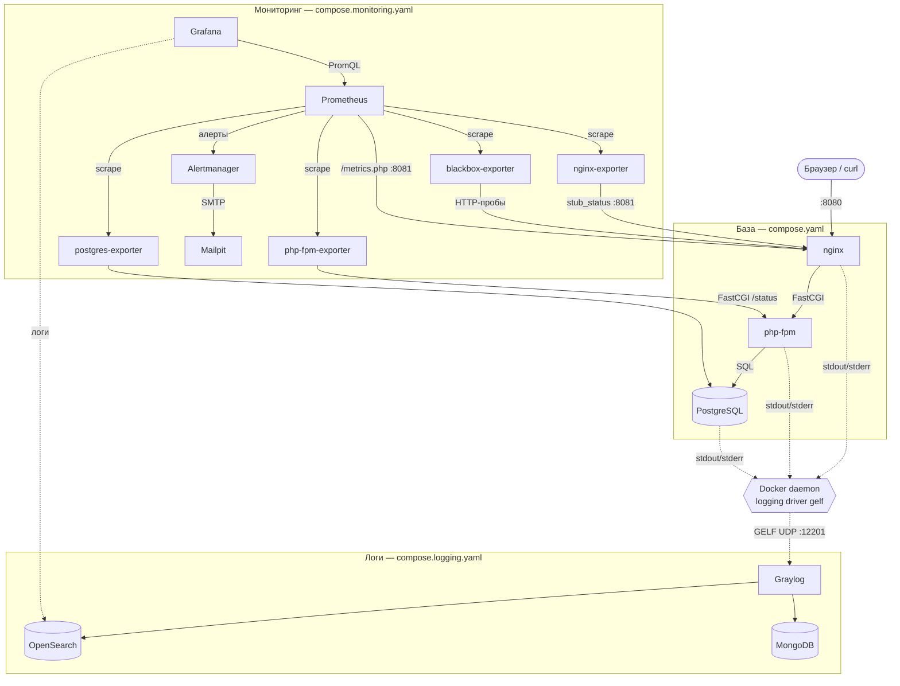

# Учебное окружение: nginx + php-fpm + PostgreSQL

Простой стек для практики Docker Compose: nginx как веб-сервер и
реверс-прокси к php-fpm 8.5 (чистый PHP, без фреймворков), PostgreSQL 18
как база данных. Все три образа собираются локально из Dockerfile в `docker/`.

## Быстрый старт

```bash
make init && make up && make composer
```

- `make init` создаёт `.env` из `.env.example` и подставляет в него UID/GID
  текущего пользователя (нужно, чтобы файлы, которые пишет php-контейнер,
  на хосте принадлежали вам, а не root).
- `make up` собирает (если ещё не собраны) и поднимает контейнеры.
- `make composer` ставит зависимости приложения в `app/vendor/`.

После этого:

- приложение — http://127.0.0.1:8080/
- health-check — http://127.0.0.1:8080/health.php
- PostgreSQL слушает `127.0.0.1:5432` — можно подключиться любым GUI-клиентом
  (логин/пароль/база — из `.env`), либо `make psql` для консоли.

Остальные команды — в `make help`.

Мониторинг, алерты и логи подключаются поверх базы (`make mon-up`,
`make logs-up`) — см. раздел [«Мониторинг и логи»](#мониторинг-и-логи).

## Когда пересобирать, а когда достаточно F5 или restart

- **Правки в `app/`** (PHP-код) — видны сразу, без пересборки и рестарта.
  `./app` смонтирован в контейнеры как volume, а opcache в dev-конфиге
  (`opcache.validate_timestamps = 1`, `opcache.revalidate_freq = 0`)
  проверяет изменения файла на каждый запрос. Просто обновите страницу.
- **Правки в конфигах** (`docker/nginx/conf.d/*.conf`, `php.ini`, `www.conf`,
  `postgresql.conf`) — тоже volume, но применяются не мгновенно: нужен
  `docker compose restart <сервис>`, потому что nginx/php-fpm/postgres
  читают их только при старте.
- **После обновления репозитория** (например, переключения на тег
  `monitoring-step-3`, где в образ php добавлен APCu) — тоже `make build`,
  `make up`, `make composer`.
- **Правки в `Dockerfile` или `app/composer.json`** (новое системное
  расширение PHP, системный пакет, PHP-зависимость) — нужен `make build`,
  затем `make up` (и `make composer`, если менялся `composer.json`).

## Ловушка: initdb выполняется только один раз

`docker/postgres/initdb/*.sql` применяется исключительно при инициализации
**пустого** тома `pgdata` — то есть один раз, при самом первом старте. Если
окружение уже поднималось и вы правите `01-init.sql`, он не выполнится
повторно сам по себе. Чтобы применить изменения — снести том и поднять
заново:

```bash
make clean && make up
```

Это удалит все данные в PostgreSQL.

То же касается мониторинга: `initdb/02-monitoring.sh` создаёт пользователя
для postgres-exporter и extension `pg_stat_statements` только на свежем томе.
Если окружение поднималось до появления мониторинга, данные терять не нужно —
есть идемпотентная цель:

```bash
make pg-monitoring
```

Она перезапускает postgres (`shared_preload_libraries` читается только при
старте сервера) и выполняет тот же скрипт. Повторный запуск безопасен.

## Мониторинг и логи

Стенд поднимается уровнями — каждый следующий добавляется поверх предыдущего
отдельным compose-файлом через `-f`, базовый `make up` остаётся лёгким:

| Уровень | Команда | Что добавляется | Память (в простое) | Образы |
|---|---|---|---|---|
| База | `make up` | nginx, php-fpm, PostgreSQL | ~60 МБ | ~1,6 ГБ |
| + мониторинг | `make mon-up` | Prometheus, экспортеры, blackbox, Grafana, Alertmanager, Mailpit | +~0,5 ГБ | +~2,5 ГБ |
| + логи | `make logs-up` | Graylog, MongoDB, OpenSearch | +~2,2 ГБ | +~4,7 ГБ |

Память замерена `docker stats` на стенде без нагрузки; под нагрузкой и при
первом старте JVM-сервисов (Graylog, OpenSearch) — больше. Для уровня «логи»
выделите Docker не меньше 6 ГБ RAM. Образы скачиваются при первом
`make mon-up` / `make logs-up` — на паре лучше скачать заранее.

```bash
make mon-up      # база + мониторинг
make mon-down    # убрать мониторинг (и логи), приложение продолжит работать
make logs-up     # база + мониторинг + Graylog
make logs-down   # убрать Graylog, мониторинг остаётся
```

### Схема



### Адреса и логины

Все порты опубликованы только на `127.0.0.1`; номера и пароли — в `.env`
(значения по умолчанию — в `.env.example`).

| Сервис | Адрес | Вход |
|---|---|---|
| Приложение | http://127.0.0.1:8080/ | — |
| Grafana | http://127.0.0.1:3000/ | просмотр без входа; правка — `admin` / `admin` |
| Prometheus | http://127.0.0.1:9090/ | — |
| Alertmanager | http://127.0.0.1:9093/ | — |
| Mailpit (письма алертов) | http://127.0.0.1:8025/ | — |
| Graylog | http://127.0.0.1:9000/ | `admin` / `admin` |
| cAdvisor (необязательно) | http://127.0.0.1:8088/ | — |
| PostgreSQL | `127.0.0.1:5432` | из `.env` |

Экспортеры, OpenSearch и MongoDB наружу не публикуются — к ним ходят только
другие контейнеры изнутри docker-сети.

### Prometheus и экспортеры

- Prometheus — http://127.0.0.1:9090/ (Status → Targets: все должны быть `UP`).
- Экспортеры наружу не публикуются: их опрашивает только Prometheus изнутри
  docker-сети. `stub_status` nginx живёт на внутреннем порту 8081, статус пула
  php-fpm (`/status`) читается напрямую по FastCGI.
- Black-box пробы (blackbox-exporter) раз в 15 секунд запрашивают
  `http://nginx/health.php` (ждём 200 и `"status":"ok"` в теле) и
  `http://nginx/nginx-health`. Результат — метрика `probe_success`: попробуйте
  `docker compose stop postgres` и запрос `probe_success` в Prometheus —
  health.php уйдёт в 0 (503), а nginx-health останется 1.

### Grafana

Datasource и дашборды подключаются через provisioning (`docker/grafana/provisioning`)
из JSON-файлов в `docker/grafana/dashboards` — после `make mon-up` ничего не
нужно настраивать руками, а удаление тома `grafana-data` ничего не ломает.

- **Сервис / Обзор сервиса** — доступность (black-box), RED по маршрутам
  (rate, доля 5xx, p50/p95/p99), насыщение пула php-fpm, PostgreSQL
  (соединения, TPS, топ медленных запросов из `pg_stat_statements`),
  бизнес-метрика. У каждой панели в (i) — пояснение, что и зачем она показывает.
- **Community / NGINX** — официальный дашборд nginx-prometheus-exporter.
- **Community / PostgreSQL Database** — grafana.com/dashboards/9628, адаптирован:
  убраны Kubernetes-переменные. Часть панелей bgwriter пуста на PostgreSQL 17+
  (счётчики переехали в `pg_stat_checkpointer`) — это ожидаемо.

Править дашборды в UI можно (под admin), но при рестарте Grafana они вернутся
к версии из git. Чтобы сохранить — Share → Export → JSON и заменить файл.

Попутная тема для лекции: postgres-exporter отдаёт текст запросов из
`pg_stat_statements` меткой `query`. Всё, что попало в текст запроса
(например, `ALTER ROLE ... PASSWORD '...'`), уедет в Prometheus — поэтому
`02-monitoring.sh` отключает `track_utility` для своей сессии.

### Метрики приложения

Под мониторингом php получает `APP_METRICS_ENABLED=1` и `auto_prepend_file`
(`docker/php/monitoring.ini`): файл `app/instrumentation/prepend.php`
выполняется перед каждым скриптом и в конце запроса пишет в APCu
`http_requests_total{method,route,status}` и гистограмму
`http_request_duration_seconds{method,route}`. Бизнес-метрика
`app_notes_created_total` считается в `index.php`. Без мониторинга всё это
выключено, `App\Metrics` превращается в no-op.

- Метрики отдаёт `/metrics.php`, но только через внутренний порт nginx 8081
  (Prometheus, job `app`). Снаружи http://127.0.0.1:8080/metrics.php — 404.
  Посмотреть руками:
  `docker compose exec nginx curl -s http://localhost:8081/metrics.php`.
- `route` — путь PHP-скрипта, а не URL: метки с неограниченным числом значений
  (query string, id) взрывают кардинальность Prometheus.
- Счётчики живут в памяти APCu и обнуляются при рестарте php — это нормально,
  `rate()`/`increase()` в Prometheus корректно обрабатывают сброс счётчика.

Демо-эндпоинты для экспериментов (работают и без мониторинга):

| URL | Что делает |
|---|---|
| `/demo/slow.php?seconds=2` | `pg_sleep` в PostgreSQL (максимум 10 с) — видно в latency, slow-log и `pg_stat_statements` |
| `/demo/error.php?rate=0.3` | отдаёт 500 с заданной вероятностью (по умолчанию всегда) |
| `/demo/cpu.php?ms=300` | жжёт CPU воркера php-fpm (максимум 2000 мс) |

### Алерты

Правила — `docker/prometheus/rules/alerts.yml` (проверяются `make mon-check`
через `promtool`), маршрутизация и подавление — `docker/alertmanager/alertmanager.yml`
(проверяется `amtool`). После правки любого из них — `make mon-reload`.

| Алерт | Условие | for | Severity → кому |
|---|---|---|---|
| TargetDown | `up == 0` | 1m | warning → team@ |
| HealthCheckFailing | `probe_success == 0` | 1m | critical → oncall@ |
| HighErrorRate | доля 5xx > 5% при трафике > 0.2 RPS | 2m | critical → oncall@ |
| HighLatencyP95 | p95 по route > 1 с | 3m | warning → team@ |
| PhpFpmPoolSaturated | очередь php-fpm > 0 или упирание в max_children | 2m | warning → team@ |
| PostgresDown | `pg_up == 0` | 30s | critical → oncall@ |
| PostgresTooManyConnections | занято > 80% max_connections | 2m | warning → team@ |

- У каждого алерта есть runbook — `docs/runbooks/<AlertName>.md`, ссылка
  приходит в письме.
- Алерты с одним `alertname` группируются в одно письмо; повтор, если алерт
  всё ещё горит, — раз в час; при восстановлении приходит письмо `[RESOLVED]`.
- `PostgresDown` подавляет `HealthCheckFailing` (inhibit_rules): когда лежит БД,
  придёт одно письмо о причине, а не два. В Alertmanager подавленный алерт
  виден с состоянием `suppressed`.
- Путь алерта: Prometheus → Alerts (inactive → pending → firing) →
  Alertmanager → письмо в Mailpit. Активные алерты есть и на дашборде
  «Обзор сервиса».

Быстро проверить цепочку: `docker compose stop postgres` — через ~1 минуту
в Mailpit придёт `[FIRING:1] PostgresDown`; `docker compose start postgres` —
через 1–2 минуты `[RESOLVED] PostgresDown`.

### cAdvisor (необязательно)

Метрики CPU/памяти/сети по каждому контейнеру. Включается профилем:

```bash
COMPOSE_PROFILES=cadvisor make mon-up
```

UI — http://127.0.0.1:8088/. На Linux работает полноценно. На Docker Desktop
(macOS, Windows/WSL2) Docker живёт внутри виртуальной машины, и cAdvisor видит
её, а не ваш компьютер: метрики «хоста» — это метрики VM, а часть метрик
(диски, файловые системы) может отсутствовать. Метрики по контейнерам при этом
есть. Без профиля Prometheus просто не находит cAdvisor и не считает его упавшим.

### Логи (Graylog)

Централизованные логи — отдельный, самый тяжёлый уровень стенда
(`compose.logging.yaml`): Graylog 7.2 + MongoDB 8.0 + OpenSearch 3.7
(версии сверены с матрицей совместимости Graylog). Поднимается поверх
мониторинга:

```bash
make logs-up     # база + мониторинг + Graylog (первый старт — 2–4 минуты)
make logs-down   # убрать Graylog, мониторинг и база остаются
```

- Graylog — http://127.0.0.1:9000/ (`admin` / `admin`, из `.env`).
- **Память:** Graylog (heap 1 ГБ) + OpenSearch (heap 512 МБ) + MongoDB —
  около 2,5–3 ГБ сверх остального стенда. В Docker Desktop
  (Settings → Resources) должно быть выделено не меньше 6 ГБ; на WSL2 —
  `memory=6GB` или больше в `%UserProfile%\.wslconfig`.
- **`vm.max_map_count`:** OpenSearch по умолчанию требует
  `vm.max_map_count >= 262144` на хосте. Стенд обходит это настройкой
  `node.store.allow_mmap=false` — работает с любым значением на Linux, macOS и
  WSL2. Если захотите вернуть mmap (быстрее на больших объёмах):
  `sudo sysctl -w vm.max_map_count=262144` на Linux, а на WSL2 —
  `wsl -d docker-desktop sysctl -w vm.max_map_count=262144`.

Как логи попадают в Graylog: nginx, php и postgres по-прежнему пишут в
stdout/stderr, а `compose.logging.yaml` переключает их Docker logging driver на
`gelf` — логи отправляет сам Docker daemon по UDP на `127.0.0.1:12201`.
`docker compose logs` при этом продолжает работать (dual logging, Docker 20.10+).
GELF input и pipeline разбора JSON создаёт одноразовый контейнер
`graylog-init` (`docker/graylog/init.py`) через REST API — повторный запуск
ничего не дублирует.

Под логированием access log nginx пишется в JSON (`request_time`,
`upstream_response_time`, `status`, `uri`, `request_id`), а pipeline Graylog
раскладывает JSON-строки (nginx и приложения) на поля. Примеры запросов в
поиске Graylog:

| Запрос | Что найдёт |
|---|---|
| `status:>=500` | все ответы 5xx в access log |
| `request_time:>1` | запросы медленнее секунды |
| `log_level:error` | ошибки, записанные приложением (`App\Log`) |
| `tag:*postgres* AND duration` | slow-log PostgreSQL (запросы > 500 мс) |
| `<request_id>` | всё о конкретном запросе (см. ниже) |

**Корреляция по request_id.** nginx присваивает каждому запросу id и отдаёт
его в заголовке ответа `X-Request-Id`; тот же id получает PHP (в логах
приложения) и PostgreSQL (как `application_name`, виден в slow-log как
`app=<id>`). Попробуйте:

```bash
curl -si 'http://127.0.0.1:8080/demo/slow.php?seconds=1' | grep -i x-request-id
```

и вставьте id в поиск Graylog — найдутся строка access log nginx, запись
приложения и строка slow-log PostgreSQL от этого запроса.

Известная особенность: под драйвером `gelf` у самого первого медленного запроса
после старта контейнера postgres теряется строка `LOG: duration ...` (строка
`DETAIL` того же запроса доходит). Воспроизводится и в Graylog, и в
`docker compose logs`, с драйвером json-file — нет. Последующие запросы
логируются полностью, поэтому для демо делайте медленный запрос дважды.

В Grafana под логированием появляется второй datasource — **Graylog (OpenSearch)**
(встроенный плагин Elasticsearch, без скачивания плагинов). В Explore можно
открыть рядом метрики и логи за один интервал.

### Сценарии для лекции

Нужен поднятый мониторинг (`make mon-up`), для сценария 3 — лучше и логи
(`make logs-up`). Нагрузку даёт k6 в контейнере (`scripts/k6/`), на хост
ничего ставить не нужно. Каждая цель печатает, куда смотреть. Алерты приходят
не сразу — `for` и группировка в Alertmanager тоже часть рассказа.

1. **БД упала** — `make demo-db-down`. `health.php` отдаёт 503, black-box проба
   падает, через ~1 мин в Mailpit приходит `[FIRING] PostgresDown`. Письма о
   HealthCheckFailing нет — его подавляет `inhibit_rules` (в Alertmanager он
   виден как suppressed). `make demo-db-up` — через 1–2 мин `[RESOLVED]`.
2. **Пул php-fpm на пределе** — `make demo-load` (~5 мин). 20 пользователей
   против 5 воркеров: на дашборде active упирается в 5, растёт очередь, растёт
   время ответа проб и p95/p99 в итоге k6. Через ~2,5 мин — `PhpFpmPoolSaturated`.
   Обратите внимание: p95 из метрик PHP почти не меняется — время в очереди
   PHP не видит, его видно только снаружи.
3. **Медленный запрос к БД** — `make demo-slow` (~4 мин). Видно в Grafana
   (p95 по route `/demo/slow.php`, топ запросов из pg_stat_statements), в
   Graylog (`tag:*postgres* AND duration`; по `request_id` из строки nginx
   находится вся цепочка), в `pg_stat_statements` (цель печатает топ в конце).
   Через ~3,5 мин — `HighLatencyP95`.
4. **Поток ошибок и роль `for`** — `make demo-errors` (~6 мин). Сначала 30 с
   сплошных ошибок: HighErrorRate только pending и гаснет, письма нет. Потом
   4 мин 30% ошибок: через ~2,5 мин firing и письмо, после — RESOLVED.

Параметры нагрузки можно подкрутить: `VUS=40 DURATION=6m make demo-load`.

### Troubleshooting

- **Target в Prometheus `DOWN`.** Status → Targets показывает ошибку. `no such
  host` — контейнер не запущен (`make mon-ps`); `connection refused` —
  запущен, но не слушает (логи сервиса). После правки `prometheus.yml` или
  правил — `make mon-check`, затем `make mon-reload`.
- **Нет метрик PostgreSQL, `pg_up = 0` при живой БД.** Окружение поднималось
  до появления мониторинга, и пользователя экспортера нет —
  `make pg-monitoring` (см. «Ловушка: initdb…»).
- **`/metrics.php` отдаёт 404.** Снаружи (:8080) так и задумано. Изнутри
  (`docker compose exec nginx curl -s http://localhost:8081/metrics.php`)
  — метрики выключены: поднимите стек через `make mon-up`, а не `make up`.
- **502 или зависший запрос сразу после `make mon-up`/`mon-down`/`logs-up`.**
  Эти команды пересоздают контейнер php, а nginx ещё до 10 секунд держит в
  кэше DNS его старый IP (`resolver ... valid=10s` в `default.conf`).
  Подождите и повторите.
- **Письма не приходят.** Цепочка: Prometheus → Alerts (алерт firing, а не
  pending?) → Alertmanager http://127.0.0.1:9093 (алерт есть? не silenced и не
  suppressed?) → Mailpit. Помните про `for`, `group_wait` (15 с) и
  `group_interval` (1 мин): от начала проблемы до письма проходит 1–3 минуты.
- **Graylog не стартует или долго в `starting`.** Почти всегда не хватает
  памяти: `docker stats`, логи `opensearch` и `graylog`. Выделите Docker
  больше RAM (≥ 6 ГБ). Первый старт — 2–4 минуты.
- **В Graylog нет сообщений.** System → Inputs: «GELF UDP (Docker)» должен быть
  RUNNING; если inputs нет — `make logs-up` ещё раз (graylog-init
  идемпотентен). Логи шлёт Docker daemon на `127.0.0.1:12201/udp`, поэтому
  порт должен быть опубликован и не занят на хосте.
- **Поиск `tag:*nginx*` выдаёт ошибку** — проверьте, что Graylog поднят из
  этого `compose.logging.yaml` (там включены wildcard в начале слова).
- **cAdvisor без имён контейнеров** — на Docker Desktop работает ограниченно,
  см. «cAdvisor (необязательно)».

### Что дальше: трейсинг

Метрики отвечают на «что и насколько плохо», логи — «что именно случилось
в конкретном запросе». Третий столп наблюдаемости — **трейсинг**: путь одного
запроса через все сервисы с длительностью каждого шага (nginx → PHP → SQL).
Наш `request_id` — его упрощённая версия для одного сервиса. Следующий шаг —
OpenTelemetry (SDK в приложении + OpenTelemetry Collector) и хранилище трейсов
вроде Grafana Tempo или Jaeger; в этот стенд намеренно не включён.

## Linux / macOS / Windows (WSL2)

`make init` подставляет в `.env` реальные UID/GID текущего пользователя, а
Dockerfile php пересоздаёт `www-data` с этими же ID (`groupmod`/`usermod -o`,
флаг `-o` — потому что нужный GID нередко уже занят какой-то системной группой
в образе, например `dialout`). За счёт этого владелец файлов, которые
php-fpm пишет в bind mount (`app/vendor` и т.п.), на хосте совпадает с вами,
а не с root — проверено на Linux, macOS и Windows/WSL2.

- **Linux** — работает «из коробки»: bind mount напрямую транслирует UID/GID
  между хостом и контейнером.
- **macOS** (Docker Desktop) — тоже напрямую: virtiofs корректно пробрасывает
  владельца файлов.
- **Windows + WSL2** — запускайте `make`/`docker compose` из терминала
  WSL2-дистрибутива (не из PowerShell/cmd) и держите проект **внутри
  файловой системы WSL2** (например `~/projects/...`), а не на `/mnt/c/...`.
  Диски Windows подключены в WSL2 через DrvFs, которая не хранит настоящие
  Unix-права — владелец файлов там не будет соответствовать UID/GID из
  `.env`, независимо от настроек Dockerfile. Также проверьте, что в Docker
  Desktop включена WSL-интеграция для вашего дистрибутива (Settings →
  Resources → WSL Integration).
- **Переносы строк** — `.gitattributes` форсирует LF для всех файлов
  репозитория, чтобы `git clone` на Windows с `core.autocrlf=true` не
  проставил CRLF в Dockerfile/Makefile/конфигах (это бы сломало их разбор
  внутри Linux-контейнеров).

## Структура

```
app/            — код приложения (PSR-4 автозагрузка App\ → src/)
docker/nginx/   — Dockerfile + конфиг nginx
docker/php/     — Dockerfile + php.ini + пул php-fpm (www.conf)
docker/postgres/— Dockerfile + postgresql.conf + init-скрипты
docker/prometheus/ — конфиг Prometheus
docker/blackbox/ — модули black-box проб
docker/grafana/ — provisioning datasource и дашборды (JSON)
docker/prometheus/rules/ — правила алертов
docker/alertmanager/ — маршрутизация и подавление алертов
docs/runbooks/  — что делать по каждому алерту
docker/nginx-exporter/ — тонкая обёртка над образом экспортера (wget для healthcheck)
compose.yaml    — оркестрация; значения по умолчанию — в .env.example
compose.monitoring.yaml — стек мониторинга, подключается через -f
compose.logging.yaml — Graylog и доставка логов, подключается поверх мониторинга
docker/graylog/ — init-скрипт настройки Graylog через API
```
